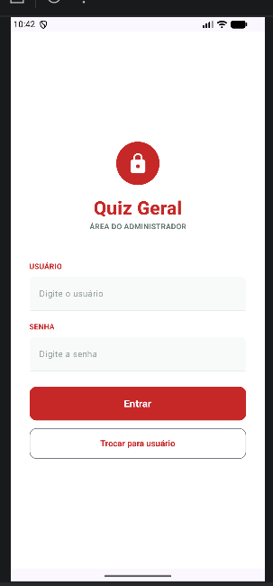
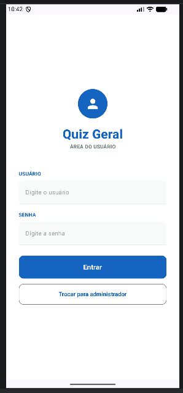
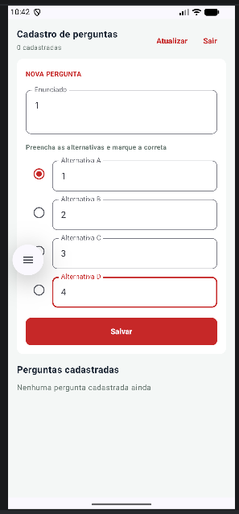
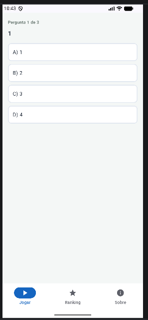
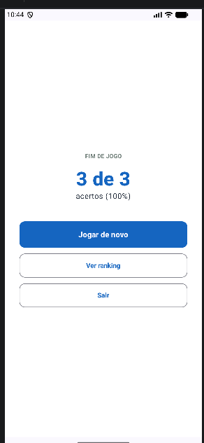
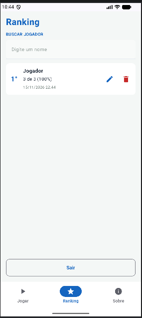
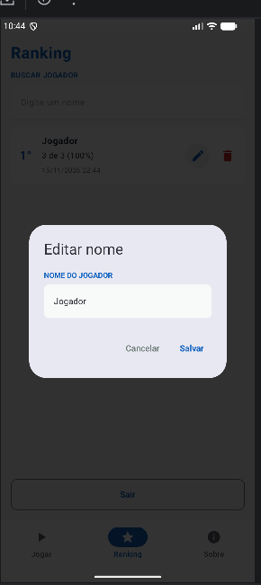
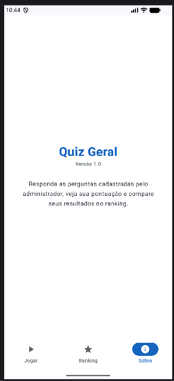
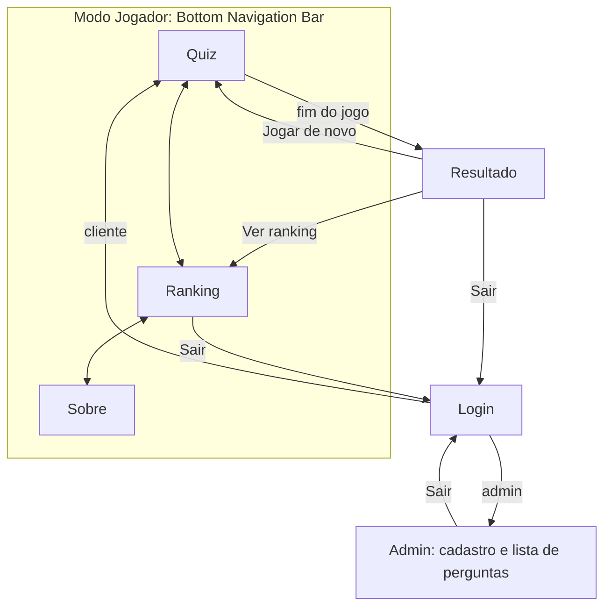

# 🎯 Quiz Geral

Aplicativo Android de perguntas e respostas, feito em **Kotlin** com **Jetpack Compose**, seguindo a arquitetura **MVVM**.

O administrador cadastra as perguntas, que ficam salvas na nuvem com o **Firebase Firestore**. O jogador responde o quiz, vê sua pontuação e acompanha seus resultados num **ranking** salvo no aparelho com o **Room**.

> Trabalho final da disciplina de Desenvolvimento Mobile.

---

## 📸 Telas

### Acesso

| Login do administrador | Login do jogador | Cadastro de perguntas (admin) |
|:---:|:---:|:---:|
|  |  |  |

### Modo jogador

| Quiz | Resultado | Ranking |
|:---:|:---:|:---:|
|  |  |  |

| Editar nome no ranking | Sobre |
|:---:|:---:|
|  |  |

### 🎥 Vídeo

▶️ **[Assista ao app funcionando (Google Drive)](https://drive.google.com/file/d/1Dbr9pH0JNqRYcllg9BCSE8g5PofhNWM6/view?usp=drive_link)**

---

## ✨ Funcionalidades

### 👤 Modo Jogador
- Responde as perguntas cadastradas, uma por vez, com feedback imediato (verde para a certa, vermelho para a errada)
- Vê o resultado final, com acertos e porcentagem
- Consulta o **ranking**, ordenado pela maior porcentagem, com **busca por nome**
- Edita o nome do jogador ou exclui um resultado do ranking
- Navega entre **Jogar**, **Ranking** e **Sobre** pela barra inferior (Bottom Navigation Bar)
- Funciona **offline**: as perguntas baixadas ficam salvas no aparelho

### 🔒 Modo Administrador
- Acesso restrito por login
- **CRUD completo** das perguntas: cadastrar, listar, editar e excluir
- As perguntas ficam no **Firebase Firestore**, e todos os aparelhos recebem a mesma lista
- Botão **Atualizar** para sincronizar com a nuvem

### 🔑 Logins de teste

| Perfil | Usuário | Senha |
|---|---|---|
| Administrador | `admin` | `admin123` |
| Jogador | `cliente` | `cliente123` |

Na tela de login, use o botão **"Trocar para usuário"** ou **"Trocar para administrador"** para escolher o perfil.

---

## 🗺️ Fluxo de navegação



---

## 🏗️ Arquitetura (MVVM)

```
Tela (Compose)
   ↓ eventos            ↑ UiState (StateFlow)
ViewModel  ←── Factory injeta o Repository
   ↓
Repository  (try-catch: isola falhas de nuvem e de banco)
   ↓                         ↓
Room (DAO, local)      Firestore (RemoteDataSource, nuvem)
```

- **Tela:** só desenha o estado e repassa os cliques para o ViewModel.
- **ViewModel:** guarda o estado da tela num `data class UiState` e aplica as regras de negócio.
- **Repository:** é a única porta de acesso aos dados. Captura os erros e devolve um resultado tratado para o ViewModel mostrar na tela.
- **Room e Firestore:** o Firestore guarda a lista oficial de perguntas, e o Room guarda uma cópia local, além do ranking.

### 📁 Estrutura de pacotes

```
com.example.myapplication
├── data
│   ├── local          → Room: entidades, DAOs e AppDatabase
│   ├── remote         → Firestore: PerguntaRemoteDataSource
│   └── repository     → PerguntaRepository, ResultadoFinalRepository
├── logic              → RegrasQuiz (validações e cálculos)
├── viewmodel          → ViewModels, UiStates e Factories
└── ui                 → Telas Compose, navegação, componentes e tema
```

### 🗃️ Dados

| Entidade | Onde fica | Operações |
|---|---|---|
| `Pergunta` | Firestore (lista oficial) + Room (cópia offline) | Criar, ler (Flow), editar e excluir, feitas pelo admin |
| `ResultadoFinal` | Room | Criar (ao terminar o quiz), ler (Flow), editar o nome e excluir, feitas pelo jogador |

---

## ✅ Requisitos do trabalho

| Requisito | Onde está implementado |
|---|---|
| MVVM com 4+ pacotes | `ui`, `data.local`, `data.repository`, `data.remote`, `logic`, `viewmodel` |
| 2+ ViewModels, cada um com seu UiState | `LoginAdmViewModel`, `PerguntasViewModel`, `QuizClienteViewModel`, `RankingViewModel` |
| ViewModelFactory | `PerguntasViewModelFactory`, `QuizClienteViewModelFactory`, `RankingViewModelFactory` |
| Tratamento de exceções no Repository | `PerguntaRepository`, `ResultadoFinalRepository` |
| 2+ `@Entity` no Room | `Pergunta`, `ResultadoFinal` |
| `Flow<List<...>>` coletado no ViewModel | `PerguntaDAO.listarTodasFlow()`, `ResultadoFinalDAO.listarTodos()` |
| CRUD completo | `PerguntaDAO`, `ResultadoFinalDAO` |
| Integração externa | Firebase Firestore (`PerguntaRemoteDataSource`) |
| 6+ telas | Login, Admin, Quiz, Resultado, Ranking, Sobre |
| Bottom Navigation Bar | `AppNavigation.kt` |
| `filter` / `map` / `sortedBy` | `RankingViewModel.montarRanking()`, `PerguntasViewModel` |
| `LazyColumn` | `TelaRanking.kt`, `TelaPerguntasAdm.kt` |
| Controle de perfil (Admin vs Jogador) | `LoginAdmViewModel` + `TelaLoginAdm.kt` |

---

## 🛠️ Tecnologias

- Kotlin 2.0
- Jetpack Compose + Material 3
- Navigation Compose
- Lifecycle ViewModel + StateFlow
- Room (com KSP)
- Firebase Firestore
- Coroutines e Flow

---

## ▶️ Como executar

1. Clone o repositório:
   ```bash
   git clone https://github.com/Gabriel-Vs20/Quiz_Geral_Mobile.git
   ```
2. Abra a pasta no **Android Studio** e espere o Gradle sincronizar.
3. Execute num emulador ou celular com **Android 7.0 (API 24)** ou superior.

O arquivo `app/google-services.json` já está no repositório, então o app conecta no Firebase do projeto sem nenhuma configuração extra. É preciso ter internet para o admin salvar perguntas e para o quiz baixar a lista atualizada.

---

## 👥 Equipe

| Integrante | GitHub | Contribuição |
|---|---|---|
| Gabriel | [@Gabriel-Vs20](https://github.com/Gabriel-Vs20) | Projeto base, cadastro de perguntas (admin), Bottom Navigation e integração com Firebase |
| Vittor Dallacqua | [@dallastinks](https://github.com/dallastinks) | Login e controle de perfil, navegação, tema, CRUD do resultado e tela de Ranking |
| Gabriel Riccetto | [@Riccetto020](https://github.com/Riccetto020) | Tela de resultado e persistência do placar |
| Rafael Moura | [@rafa-moura02](https://github.com/rafa-moura02) | Tela do quiz, com ViewModel, UiState e Factory |
